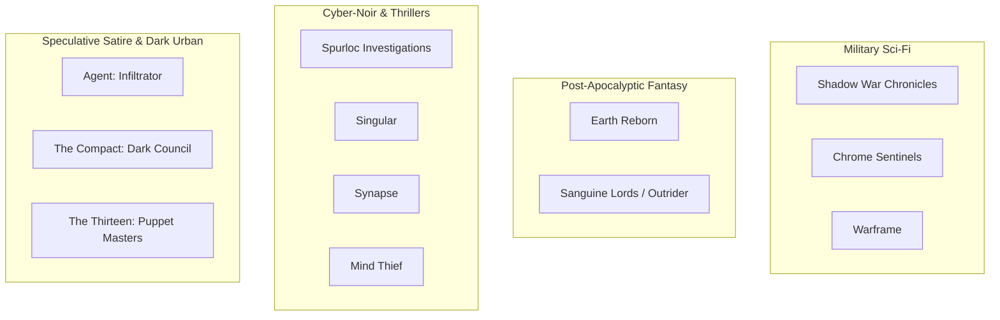

# Editorial & Series Strategy

## Overview
Strategic blueprints for release cadence, storytelling formats, audience segmentation, and intellectual property development across the Ray Bayly author platform.

---

## 1. Publishing & Format Models

### Long-Form Novel Releases
- **Target Franchises**: *Earth Reborn*, *Shadow War Chronicles*, *Sanguine Relics*, *Singular*, *Synapse*, *Mind Thief*.
- **Structural Blueprint**:
  - Word count: 75,000 – 95,000 words per novel.
  - Three-act structure with tightly controlled episodic pacing and cliffhanger chapter hooks.
  - Formats: Paperback, Hardcover, Kindle / EPUB, and Audiobook editions.

### Serialized & Episodic Releases (Amazon Kindle Vella / Web Fiction)
- **Target Franchises**: *Chrome: Sentinels of the Republic*, *Spurloc Crime Files*, *Agent (Infiltrator)*.
- **Structural Blueprint**:
  - Episode length: 1,500 – 2,500 words per episode.
  - High episodic velocity: Each installment begins with immediate tension, resolves an micro-crisis, and closes on a dramatic question or narrative twist.
  - Release schedule: 2 episodes weekly to maintain reader algorithmic momentum.
  - Omnibus Conversion: Collect every 25 episodes into compiled trade paperback volumes.

---

## 2. Audience Segmentation & Genre Matrix

---

## 3. Canonical Continuity & World Rules

### Hierarchy of Truth
1. **Tier 1: Master Manuscripts (`manuscripts/`)**: The authoritative finished prose, finalized character dialogue, and established geography.
2. **Tier 2: Lore & Codices (`lore/`)**: The binding historical rules, faction structures, and metaphysical laws governing the universe.
3. **Tier 3: Outlines & Story Bibles (`outlines/`, `characters/`)**: Working roadmaps, act structures, and biographical profiles.
4. **Tier 4: Working Ideas & Concepts (`ideas/`)**: Unvetted prompts, raw brainstorming notes, and prospective expansions.

### Cross-Series Isolation Principle
- Each universe operates on its own self-contained cosmological laws unless explicitly designated as a shared multiverse branch:
  - *Earth Reborn* remains strictly post-apocalyptic sci-fantasy rooted in pre-collapse Earth.
  - *Shadow War Chronicles* operates within interstellar military sci-fi void physics.
  - *Spurloc* operates within the high-tech/occult blend of Metroplex.
  - *The Compact* and *The Thirteen* share the hidden preternatural modern Earth timeline.
