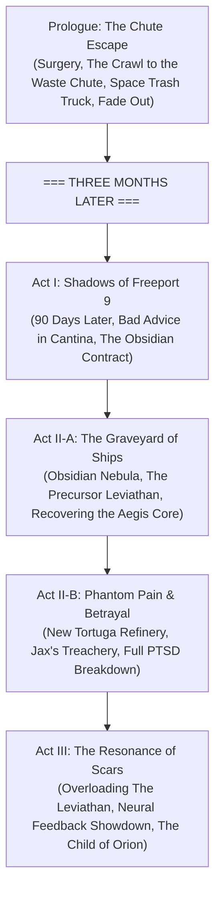

# Outline: Orion's Child (Orion Chronicles — Book 1)

## High Concept & Series Premise
Captured by the sadomasochistic warlord **Vengeance** at the climax of *Vengeance* (Book 3 of *The Shadow War Chronicles*), **Gracie Campbell** is subjected to a horrific surgical procedure: Vengeance implants **The Box**—an obsidian biomechanical containment canister housing the digitized consciousness of **a prisoner tortured for an entire century**—directly into her brainstem. 

Rather than waiting for her legendary father Captain Blake Campbell to rescue her, **Gracie escapes on her own immediately following the surgery without killing a soul**. Left alone on the operating table for a solitary moment while her captors step away, Gracie summons raw willpower through blinding neuro-surgical agony. Crawling across the floor, she slips into an automated garbage chute, tumbling into a space-faring waste hauler beneath heaps of scrap and discarded refuse. The hatch slams shut, the trash scow undocks into the vacuum, and she passes out into blackness.

**FADE OUT.**

The story jumps forward **three months later**.

Now surviving on the lawless Orion fringe aboard *The Starlight Drifter*, Gracie navigates life with a century-old, severely traumatized entity permanently wired into her head. Broken by one hundred years of torment, the prisoner suffers from catastrophic, unpredictable PTSD. While the entity constantly whispers warnings and underworld advice directly into her auditory nerve, **the Box doesn't always give the best advice**—swinging between flashes of tactical brilliance, paralyzing panic, and irrational paranoia.

When a high-stakes salvage contract in the Obsidian Nebula unearths the *Aegis Core*—an ancient precursor technology coveted by syndicate warlord Baron Marcus Vargas and awakened Shadow AI swarms—Gracie must protect her crew, outwit the predators of the fringe, and master the unstable ghost inside her mind.

---

## The Canon Anchor & The Chute Escape

### 1. The Epilogue of *Vengeance*
At the conclusion of *Vengeance* (Shadow War Chronicles Book 3), Blake Campbell brokers humanity's entry into the Council of Free Planets. In orbit, a shuttle leaving the *Jamestown* is vaporized. The crippled holo-specter of Vengeance hacks the *Revenant*’s bridge:
> *"Oh captain, I am not even close to done with you, my friend. Oh, by the way, say hi to my new friend."*

An image of Gracie appears—bruised, pale, in prisoner rags—whispering *"Daddy?"* before transmission cuts black.

### 2. The Chute Escape (Prologue)
- Vengeance’s cyber-surgeons finish grafting The Box into Gracie’s cervical spine. 
- Thinking she is completely paralyzed by neuro-blockers and surgical shock, the medical attendants leave the recovery bay unattended for a brief moment.
- Gracie refuses to remain a victim. She does not engage in a cinematic shootout or kill anyone—she is in pure survival mode. Gritting her teeth against blinding spinal agony and fever, she slides off the slab and claws her way across the deck to an open waste chute.
- She tumbles down into the dark, reeking hold of an automated orbital trash scow just as the hydraulic compactors cycle. 
- The scow undocks and enters sub-light transit into the waste lanes. Gracie loses consciousness in the cold garbage. **Fade out.**

### 3. Three Months Later
- When Blake Campbell and the *Revenant* eventually raid Vengeance’s black facility in *Renegades*, they find an empty table and a severed blood trail leading to an incinerator/waste chute. Blake is left believing his daughter may be dead or lost to the void.
- In reality, Gracie survived the trash barge, crawled out at an outer-rim scrap depot, and spent the last ninety days nursing her infected surgical wounds with black-market stims, buying a battered vessel (*The Starlight Drifter*), hiring a crew, and learning how to live with the frantic, traumatized ghost in her skull.

---

## Core Dynamic: Gracie & The Passenger (The Box)
- **The Entity**: A legendary operative captured a century ago by Vengeance. Over 100 years of vivisection, neural flaying, and sensory deprivation, the prisoner's physical form was consumed, but their consciousness was digitized and trapped inside an indestructible neural canister.
- **The PTSD & Erratic Advice**:
  - The entity retains peerless tactical reflexes, knowledge of pre-war black sites, and an uncanny ability to read combat trajectories.
  - BUT having endured 100 years of torment, the prisoner suffers from severe, unmedicated PTSD. Sudden loud clangs, bright surgical lights, restraint cuffs, ozone, and mechanical sounds trigger blinding panic attacks and hallucinations.
  - The prisoner's advice is volatile and often dangerous: swinging from surgical precision to irrational paranoia (*"Shoot that trader before he poisons the air!"*, *"Vent the hangar bay! Fire kills everything!"*, *"Trust nobody—even your engineer is building a cage for us!"*).
  - Gracie must constantly evaluate, second-guess, and argue sub-vocally with the passenger, separating genuine survival instincts from trauma-driven delusions.

---

## Master Architecture & Three-Act Structure

---

## Prologue & 16-Chapter Beat Breakdown

### Prologue: *The Chute*
- **Scene**: Vengeance's black site recovery bay. Fresh incision wounds burn on Gracie's neck; the dark obsidian box pulses against her spine. 
- **The Escape**: The doctors leave her alone for a brief moment. Gracie does not kill anyone; she uses every ounce of adrenaline to pull herself off the gurney, dragging her trembling limbs across the cold deck to a wall-mounted waste disposal hatch.
- **The Fall**: She slips into the garbage chute, sliding down into the belly of an automated space trash truck loaded with scrap metal and biological waste. The airlock hisses shut. The thrusters fire. Gracie blacks out into total darkness.
- **Fade Out.**

---

### Three Months Later

### Chapter 1: *The Noise in the Dark*
- **Three Months Later**: Gracie sits in the grimy, neon-lit underbelly of Freeport 9, sipping harsh synth-whiskey while nursing a throbbing headache at the base of her skull. It has been ninety days since she tumbled out of that trash scow, ninety days of hiding, scrounging, and learning to live with the entity in her neck.
- **The Passenger Speaks**: The Box hums. As a syndicate broker approaches with a high-paying salvage tip, the century-tortured passenger screams bloody murder in Gracie’s ears, insisting the broker has a bone-saw under the table and demanding Gracie draw and shoot him immediately.
- **Escalation**: Gracie suppresses the phantom panic, negotiates the coordinates for a precursor wreck in the Obsidian Nebula, but is forced into a brutal back-alley brawl when local bounty hunters try to claim the bounty on Blake Campbell's runaway daughter. Gracie fights through conflicting advice from the Box, relying on the raw grit that kept her alive in the garbage hauler.

### Chapter 2: *The Starlight Drifter*
- Gracie boards her battered, beloved salvage vessel, *The Starlight Drifter*, which she purchased with salvage scrip over the last three months.
- We meet her crew: grumpy hydraulic-armed chief engineer **Kaelen "Kael" Voss**, sharp-tongued street-slicer **Tessandra "Tess" Renn**, and deadpan reprogrammed combat synthetic **Unit-7 ("Seven")**.
- Gracie conceals her neural seizures and the existence of the Box from her crew, fiercely guarding the independence she earned. When Kael flexes his titanium hydraulic prosthetic near Gracie, the passenger experiences a PTSD spike, mistaking the mechanical whirr for Vengeance's surgical clamps.

### Chapter 3: *The Graveyard of Ships*
- *The Starlight Drifter* navigates past outer Union patrols and enters the eerie, sensor-dead Obsidian Nebula.
- They arrive at a cosmic ship graveyard: hundreds of shattered warships from a forgotten war drifting in silent suspension.
- In the absolute silence of the void, the passenger’s frantic screaming quiets to a low, melancholic murmur—the first calm Gracie has felt in three months. But the peace is shattered when the passenger recognizes the markings on an ancient five-kilometer precursor dreadnought: memories from a hundred years ago surface in fractured flashes.

### Chapter 4: *Cold Iron and Phantom Agony*
- Gracie leads an EVA away team (Gracie, Kael, Seven) inside the frozen, breached precursor hull.
- As they navigate zero-gravity corridors choked with ancient battle debris, the passenger provides uncanny navigation data, guiding them past automated kinetic traps.
- In the central engineering sanctum, they discover the *Aegis Core*—a glowing sapphire quantum matrix humming at a frequency that causes the Box in Gracie’s neck to violently resonate.

### Chapter 5: *Uninvited Guests*
- As Kael decouples the Aegis Core, a heavy strike frigate belonging to underworld warlord **Baron Marcus Vargas** latches onto the derelict airlock.
- Syndicate enforcers breach the engineering chamber with heavy plasma rifles and flash-bangs.
- The flash-bang sparks a massive panic attack in the passenger, who relives a century of blinding interrogation lamps. The entity screams contradictory advice (*"Kill yourself before they take us alive!"* vs *"Vent the atmosphere!"*). Gracie fights through blinding neural pain, using Seven's suppressive fire and her own plasma sidearms to secure the core and fall back.

### Chapter 6: *The Fracture Jump*
- Escaping back to *The Drifter*, Gracie guns sub-light thrusters under heavy fire from the syndicate frigate.
- With drive manifolds burning out, Kael hot-wires the Aegis Core directly into the jump coils.
- The ship initiates an unstable blind jump through folded space. The dimensional warp overloads the Box, knocking Gracie unconscious and subjecting her to a terrifying psychic bleed: experiencing firsthand the prisoner’s hundred years of solitary confinement, sensory flaying, and the memory of her own desperate crawl down the garbage chute three months ago.

### Chapter 7: *The Voice in the Skull*
- Gracie awakens in the med-bay with Kael and Tess hovering over her. Kael’s bio-scanners have detected the illegal, biomechanical black box grafted into her brainstem.
- Cornered, Gracie confesses the entire truth: Vengeance placed the Box in her, but she escaped on her own down a waste chute into a space trash hauler. She fled into the outer rim because she refused to be pitied by Blake Campbell or locked in a Union military medical lab as an experiment.
- The crew stands firmly with their captain. Kael notes that the Aegis Core's quantum field emits a stabilizing sub-harmonic that temporarily suppresses the Box's degradation, offering the passenger the first relief from pain in a century.

### Chapter 8: *Port of Thieves (New Tortuga)*
- With *The Drifter* scorched and leaking plasma coolant, the crew docks at **New Tortuga**—a lawless black-market haven built into a hollowed-out nickel asteroid.
- Gracie needs coolant, replacement fuel rods, and ammunition.
- She seeks out an old information broker named Jax. In her head, the passenger—eager to prove its usefulness—insists Jax is trustworthy because "he has cowardly eyes and won't cross a Campbell." This proves to be **horrible advice**: Jax has already sold their docking berth to Baron Vargas for a massive reward.

### Chapter 9: *The Refinery Ambush*
- Vargas’s elite cartel hit-squad corners Gracie, Kael, and Tess inside a subterranean geothermal refinery.
- Realizing it gave bad advice, the passenger enters a catastrophic guilt-and-terror spiral: *"They're going to strap us to the table again! Shoot the fuel pipes! Burn us all!"*
- Gracie refuses to surrender to the panic. She talks the passenger down while in cover: *"I dragged us through a garbage chute in the freezing dark three months ago. We are not dying in this filthy ditch."* Calmed by Gracie's grit, the passenger spots a structural weak point in the refinery's steam pressure vents. Tess triggers the blowout, and Seven provides covering fire as they fight their way back toward the docks.

### Chapter 10: *Ghosts of the Father*
- Hiding in an abandoned cargo hangar, Tess intercepts an emergency subspace broadcast: Captain Blake Campbell and the *Revenant* are battling rogue Shadow AI fleets near the core worlds.
- The passenger sneers with bitter trauma: *"Your father couldn't save me from a century of hell, and he didn't pull you out of Vengeance's trash truck—you pulled yourself out. We don't need him."*
- Gracie confronts her lingering anger and grief. She realizes she doesn't hate her father, but her life belongs to her alone. She fought her way out of Vengeance's operating room, and she will protect the innocent people of the fringe on her own terms.

### Chapter 11: *The Swarm Awakens*
- The energy pulse from the Aegis Core’s earlier jump reaches deep space, re-activating a dormant hive of **biomechanical Shadow AI splinter ships**.
- The AI swarm descends upon New Tortuga, raining kinetic beams upon the station's orbital rings and slaughtering syndicate guards.
- The passenger, having been studied and analyzed by Vengeance alongside early AI weapons a century ago, recognizes the swarm's algorithmic attack vectors, giving Gracie vital tactical maneuvers to organize an evacuation corridor for trapped civilian miners.

### Chapter 12: *Siege of the Drift*
- *The Starlight Drifter* leads an escape convoy of unarmed freighters through a deadly swarm gauntlet.
- Baron Vargas's syndicate forces are in full disarray, firing wildly at both the AI drones and civilian ships.
- Working in tandem, Gracie filters the passenger's hyper-aggressive instincts into razor-sharp piloting maneuvers, while Kael channels the Aegis Core into a localized energy envelope, shielding the refugees as they leap into hyperspace.

### Chapter 13: *The Baron's Trap*
- As the last civilian ship jumps, Baron Vargas’s super-dreadnought, *The Black Leviathan*, decloaks and ensnares *The Starlight Drifter* in a heavy gravimetric tractor beam.
- Vargas hails *The Drifter*, revealing his syndicate purchased black-site research directly from Vengeance's former associates. Vargas knows about the Box in Gracie’s skull and wants both the Aegis Core and the century-old prisoner's decrypted memories to rule the Orion sector.
- Vargas gives Gracie a choice: surrender herself and the Core, or watch *The Drifter* be crushed in the tractor vice.

### Chapter 14: *Breach and Clear*
- The passenger, terrified of returning to captivity, screams for Gracie to self-destruct *The Drifter*'s reactor: *"Blow the core! Never let them take us alive!"*
- Gracie rejects the bad advice. Instead of dying, she weapons-tunes the Aegis Core, deliberately overloading the tractor beam and propelling *The Drifter* at ramming speed into *The Leviathan's* primary hangar bay.
- Remembering how she crawled out of the dark three months ago, Gracie channels her unyielding survival instinct, leading Kael and Seven in a relentless counter-boarding assault toward the command deck.

### Chapter 15: *Clash of Titans & The Shared Scream*
- Gracie breaches the observation bridge and confronts Baron Vargas, who is clad in heavily reinforced cybernetic exoskeletal armor.
- During their duel, Vargas activates a neural disruption field designed to subdue high-grade cyberware. The frequency violently activates the Box, slamming Gracie and the passenger with agonizing phantom torture sensations.
- As Gracie falls to her knees, Vargas gloats that Blake Campbell's daughter was bred to be a slave.
- Pushed to the brink, Gracie stops fighting the passenger's pain. Embracing the shared trauma of a century of torture and the raw will that carried her down the garbage chute, Gracie synchronizes her neural accelerator with the Box. She discharges the stored torment and quantum energy directly into Vargas’s cybernetic uplink, frying his nervous system and shattering his armor.

### Chapter 16: *Child of Orion*
- With Vargas defeated and *The Black Leviathan* disabled, Gracie seizes control of the syndicate network, freeing the indentured miners and scattering the cartel's enforcers across the fringe.
- Kael permanently mounts the Aegis Core into *The Starlight Drifter*, routing a dedicated quantum dampener to Gracie's neural harness. For the first time, the Box is at peace—the passenger's century of screaming settles into a quiet, protective alliance.
- Gracie sends a short, encrypted transmission to Blake Campbell's personal comms: *"I made it out on my own, Dad. And I'm making my own way out here. Stop looking for me."*
- Standing on the bridge alongside Kael, Tess, and Seven, Gracie Campbell looks out into the glittering stars of the Orion Belt—no longer Blake's missing daughter or Vengeance's captive, but the self-made, unbreakable **Child of Orion**.
