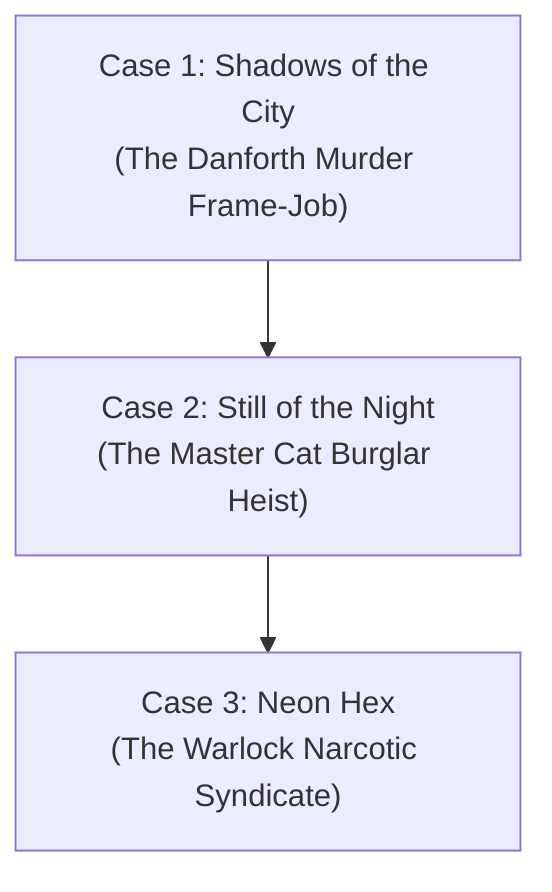

# Outline: Spurloc Investigations (Cyber-Noir Mystery Series)

## Series Concept
A hardboiled, neon-drenched cyber-noir procedural set in the futuristic megacity of **Metroplex**. Detective Martin Spurloc—a half-cybernetic ex-police warlock—partners with **Elvis**, a snarky, escaped military-grade AI speaking with the drawl of an old-world rock legend, to solve the crimes that corporate security and municipal cops refuse to touch.

---

## Series Arc Overview

---

## Case 1: *Shadows of the City*

### High Concept & Logline
It always starts with a girl. When Spurloc is hired to tail the philandering heir to the greatest corporate fortune in Metroplex, he ends up standing over the billionaire's corpse with the murder weapon in hand and the entire city police force on his tail.

### Act I: The Spire Commission
- **The Client**: Spurloc is summoned to an opulent glass penthouse in the Spire District by a mysterious femme fatale claiming her husband, industrial billionaire **James Danforth III**, is carrying on an illicit affair in the Sinks.
- **The Stakeout**: Spurloc and Elvis tail Danforth to a secluded private warlock club in the Lower Boroughs. When Spurloc breaches the VIP lounge after hearing gunshots, he finds Danforth dead—executed with Spurloc’s signature mil-spec kinetic ammunition.
- **The Frame**: The client vanishes, all digital security footage has been wiped and replaced with deepfake recordings of Spurloc firing the lethal shot, and MMPD tactical units surround the building within seconds.

### Act II: On the Run in the Sinks
- **Underground Fugitive**: Spurloc blows an escape hatch into the subterranean transit tunnels. Elvis hacks the city’s traffic AI to trigger gridlocks, buying them precious minutes.
- **Forensic Slicing**: Elvis analyzes acoustic residue from the murder weapon, detecting an anomalous electromagnetic frequency—the hallmark of an experimental cybernetic firearm manufactured by Danforth’s own corporate rival, Kurosawa Dynamics.
- **The Betrayal**: Spurloc tracks down the femme fatale in a rain-soaked industrial district, discovering she is a bio-synthetic operative contracted by Danforth’s own vice president, who orchestrated the hit to trigger a corporate takeover.

### Act III: The Neon Confrontation
- **Breaching the Boardroom**: Spurloc and Elvis hijack Danforth Spire's private elevator array, broadcasting the unedited forensic telemetries and the VP's confession live to every media network and police precinct in Metroplex.
- **The Roof Shootout**: Spurloc battles corporate death squads on the wind-lashed helipad, using a fusion of warlock lightning sigils and his titanium cyber-arm to take down the VP’s armored gunship.
- **Aftermath**: Spurloc’s name is cleared with MMPD, but he has earned the permanent enmity of the Metroplex corporate oligarchy.

---

## Case 2: *Still of the Night*

### High Concept & Logline
When the world's most elusive, gentleman cat burglar Hiro Yakatashi is framed for a multi-million-dollar art heist on the eve of his retirement, he calls the only man who understands how to beat an impossible frame: Martin Spurloc.

### Act I: A Midnight Call from an Old Thief
- **The Legend**: Hiro Yakatashi has danced circles around Interpol for thirty years without ever firing a bullet. On the verge of retirement to a quiet island, he is arrested at a private airport holding an empty crate that supposedly contained the priceless *Celestial Triptych*.
- **The Plea**: Hiro contacts Spurloc through a secure encrypted channel. He insists he was double-crossed by an anonymous broker who promised him a clean final appraisal, not a heist.

### Act II: The Art of Deception
- **Infiltrating the Vault**: Spurloc and Hiro break out of temporary custody and investigate the crime scene—an impenetrable subterranean vault deep inside the Metroplex Museum of Antiquities.
- **Digital Phantom**: Elvis discovers that the security logs were not bypassed—they were overridden by an inside clearance code belonging to the museum’s own chief curator, who is heavily in debt to an underworld gambling cartel.
- **The Double Bluff**: The stolen art piece is not just valuable canvas; hidden beneath the paint is an encrypted hardware ledger holding the private cryptographic keys to the city's black-market weapons network.

### Act III: The High-Speed Heist Retrieval
- **Pursuit on the Monorail**: Spurloc and Elvis chase the cartel couriers across the high-speed MagLev transit lines threading between Metroplex skyscrapers.
- **The Rooftop Extraction**: Combining Hiro’s acrobatic thievery and Spurloc’s kinetic warlock wards, the pair recover the ledger, expose the curator’s scheme, and leave Interpol holding the real criminals while Hiro slips away into quiet retirement.
